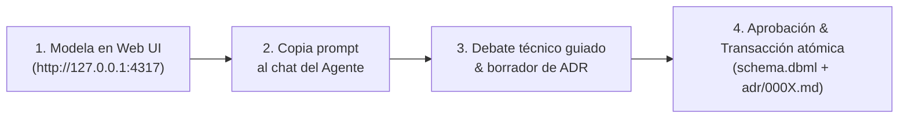

# schema-memory

> **Memoria canónica de esquemas de base de datos, flujo de Architecture Decision Records (ADRs) y compañero de pair programming para desarrolladores que trabajan con asistentes de IA.**

[](https://www.npmjs.com/package/schema-memory)
[](https://www.typescriptlang.org/)
[](https://nodejs.org/)
[](https://bun.sh/)
[-success.svg)](#1-qu%C3%A9-es-schema-memory)
[](LICENSE)

---

## 1. ¿Qué es `schema-memory`?

Al desarrollar sistemas a gran velocidad con asistentes de Inteligencia Artificial (Antigravity, OpenCode, Claude Code, Cursor), surge un problema crítico: **se pierde el rastro de por qué se toman decisiones sobre las bases de datos**. Las tablas se modifican sin registrar alternativas descartadas ni evaluar trade-offs, y volver a explicarle manualmente el contexto del esquema al agente resulta repetitivo y propenso a desincronizaciones.

`schema-memory` soluciona esto uniendo el modelado visual local con la memoria persistente del agente:

- 🎨 **Lienzo Visual Interactivo**: Diseña y edita tablas en un canvas local basado en **DBML canónico y neutral** (desacoplado de ORMs o SQL específicos).
- 🤖 **Debate Guiado con IA**: El agente no aplica cambios de base de datos a ciegas; antes de tocar código, inicia un debate arquitectónico obligatorio contigo en el chat.
- 📜 **ADRs Inmutables en Git**: Cada confirmación genera un Architecture Decision Record versionado en `.schema-memory/adr/` con las razones y alternativas técnicas.
- 🧠 **Memoria Persistente (Engram / Notion)**: Genera automáticamente resúmenes estructurados para tus herramientas de memoria a largo plazo.
- ⚡ **Zero Docker**: Corre como una aplicación nativa ultraligera sobre Node.js o Bun, sin contenedores ni daemons pesados.

---

## 2. Inicio Rápido (Quick Start)

### Opción A: Ejecución Directa con `npx` o `bunx` (Recomendada / Zero-Install)

Ejecuta `schema-memory` directamente sin necesidad de instalar paquetes globales:

```bash
# Con npm
npx schema-memory

# Con Bun
bunx schema-memory

# Con pnpm
pnpm dlx schema-memory
```

> [!TIP]
> En la primera ejecución, si tus agentes de IA aún no están configurados, `schema-memory` te ofrecerá ejecutar `setup` automáticamente de forma interactiva.

### Opción B: Instalar el CLI global `sm`

Para disponer del comando corto **`sm`** en tu terminal en **macOS, Linux y Windows**:

```bash
# 1. Instalar globalmente
npm i -g schema-memory
# o con Bun:
bun add -g schema-memory

# 2. Configurar agentes de IA (OpenCode, Antigravity y skills globales)
sm setup

# 3. Iniciar la interfaz web
sm
```

---

## 3. Flujo de Trabajo con IA en 4 Pasos



1. **Diseña en el Canvas**: Abre la UI local (`sm`), crea tablas, añade columnas o relaciones.
2. **Copia el Prompt al Agente**: Haz clic en el botón de la UI para transferir los cambios pendientes a tu asistente de IA (OpenCode, Antigravity, Claude Code).
3. **Debate Guiado de Decisiones**: La IA analiza el diff con `get_pending_changes()` y debate contigo: *¿Por qué separamos esta tabla? ¿Qué trade-offs evaluamos? ¿Qué alternativas descartamos?*.
4. **Confirmación Atómica**: Al aprobar la decisión en el chat, la IA ejecuta `confirm_change(userConfirmed=true)`, actualizando el esquema canónico y generando el ADR inmutable en tu repositorio.

---

## 4. Referencia de Comandos CLI

| Comando | Alias | Descripción |
| :--- | :--- | :--- |
| `sm` | `sm ui` | Inicia la API local y abre el canvas visual en `http://127.0.0.1:4317` (puerto configurable con `-p`). |
| `sm init` | `sm add` | Vincula el proyecto actual o la ruta especificada (`sm add /ruta/proyecto`). |
| `sm ls` | `sm status` | Muestra el estado de proyectos registrados, cambios pendientes y ADRs. |
| `sm rm [id]` | — | Desvincula un proyecto de `schema-memory`. |
| `sm setup` | — | Configura de forma no destructiva los servidores MCP y skills para **OpenCode**, **Antigravity** y agentes estándar (`--target all\|opencode\|antigravity`). |
| `sm doctor` | — | Diagnóstico de salud de registro MCP, binarios en el PATH y estado de proyectos. |
| `sm mcp` | — | Inicia el servidor MCP sobre `stdio` para comunicación directa con agentes. |

---

## 5. Integración con Agentes de IA

`schema-memory` es agnóstico de agente e implementa el protocolo abierto **Model Context Protocol (MCP)**:

- **OpenCode**: Configuración nativa V2 en `~/.config/opencode/opencode.json` con comando stdio, skills y reglas en `AGENTS.md`.
- **Google Antigravity**: Registro en `~/.gemini/config/mcp_config.json`, regla global en `GEMINI.md` y plugin oficial.
- **Claude Code & Agentes Estándar**: Soporte para la especificación abierta `~/.agents/skills/schema-memory/SKILL.md`.

---

## 6. Documentación Detallada

Para profundizar en el diseño interno, la especificación técnica o contribuir al código:

- 🏗️ **[Arquitectura de Sistemas y Estructura Interna](https://github.com/RaixsG/schema-memory/blob/main/docs/architecture.md)**: Diseño por capas, monorepo (`packages/core`, `server`, `mcp`, `cli`, `apps/web`), Zero Docker y seguridad local anti DNS-rebinding.
- 🔌 **[Protocolo MCP e Integración con Agentes IA](https://github.com/RaixsG/schema-memory/blob/main/docs/mcp.md)**: Referencia detallada de las 12 herramientas MCP, ciclo de debate guiado y directivas de aislamiento estricto.
- 📁 **[Especificación del Repositorio Cliente (`.schema-memory/`)](https://github.com/RaixsG/schema-memory/blob/main/docs/specification.md)**: Formato de `schema.dbml`, ADRs inmutables en Markdown, metadatos YAML y detección de drift.
- 🛠️ **[Guía de Contribución y Desarrollo Local](https://github.com/RaixsG/schema-memory/blob/main/CONTRIBUTING.md)**: Setup con `pnpm`, desarrollo con hot-reload (`pnpm dev`), suite de tests con Vitest y compilación de binarios standalone.

---

## Licencia

[MIT](LICENSE) © 2026 RaixsG
