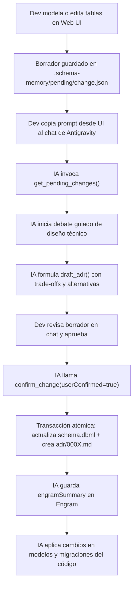

# schema-memory

> **Memoria canónica de esquemas de base de datos, flujo de Architecture Decision Records (ADRs) y compañero de pair programming para desarrolladores freelance que trabajan con asistentes de IA.**

[](https://www.typescriptlang.org/)
[](https://nodejs.org/)
[](https://pnpm.io/)
[-success.svg)](#stack-tecnol%C3%B3gico)
[](LICENSE)

---

## 1. Contexto y Motivación: ¿Por qué existe `schema-memory`?

Como desarrollador freelance o full-stack, el ritmo de trabajo con herramientas de Inteligencia Artificial (Antigravity, Claude Code, Cursor, Copilot) es vertiginoso. Delegar tareas permite construir sistemas a gran velocidad, pero introduce un problema crítico:

> **El problema del ritmo acelerado:** Cuanto más rápido avanzas delegando en la IA, **menos interiorizas cada decisión técnica**. Se pierde el rastro de *por qué* una tabla se diseñó de cierta forma, qué alternativas se descartaron, cómo estaba implementada antes y por qué se decidió cambiarla.

Además, cuando necesitas entender cómo funcionan los datos en un sistema:
1. Diseñas un diagrama de BD en una herramienta externa (drawDB, ChartDB, DrawSQL, etc.).
2. Modificas algo en la herramienta visual.
3. Tienes que **volver a explicarle manualmente a la IA** todo el diagrama y el contexto para que pueda actualizar el código o generar migraciones.
4. Si intentas registrar estas decisiones a mano en herramientas como **Notion** o **Engram**, el proceso se vuelve manual, repetitivo y propenso a desincronizarse del código fuente.

### La Solución de `schema-memory`

`schema-memory` resuelve este problema creando un puente directo entre el modelado visual, el repositorio del cliente y tu agente de IA:

1. **Esquema canónico neutral en cada repositorio:** El esquema canónico vive dentro de la carpeta `.schema-memory/schema.dbml` de cada proyecto de cliente en formato **DBML neutral**.
2. **Debate obligatorio de diseño con la IA:** Cuando realizas cambios en el diagrama (o cuando la IA propone un cambio), no se aplican de inmediato al código. Se genera un cambio pendiente y la IA inicia un **debate guiado** contigo: *"¿Por qué separamos esta tabla? ¿Qué trade-offs evaluamos? ¿Qué alternativas descartamos?"*.
3. **ADRs inmutables versionados en Git:** Cada confirmación genera un archivo Markdown inmutable en `.schema-memory/adr/000X-[slug].md` con metadatos de las tablas afectadas.
4. **Memoria persistente en Engram:** La herramienta genera automáticamente un `engramSummary` para que la IA lo guarde en tu sistema de memoria a largo plazo (Engram / Notion).
5. **Cero Docker, 100% ligero:** Corre nativo sobre Node.js y pnpm como una aplicación local y un servidor MCP global multi-proyecto.

---

## 2. Stack Tecnológico

`schema-memory` fue diseñado con el principio de mínima fricción y máxima ligereza:

| Capa | Tecnologías | Propósito |
| :--- | :--- | :--- |
| **Runtime & Gestor** | Node.js 22, pnpm workspaces | Monorepo modular de alto rendimiento |
| **Lenguaje** | TypeScript (Strict mode, ESM nativo) | Seguridad de tipos de extremo a extremo |
| **Modelado DBML** | `@dbml/core`, `zod` | AST DBML, validación, diffing y serializador determinista |
| **Servidor MCP** | `@modelcontextprotocol/sdk` (v1.x) | 12 tools sobre stdio para integración con agentes de IA |
| **Backend REST** | `hono`, `@hono/node-server` | API local (`127.0.0.1:4317`) con protección anti DNS-rebinding |
| **Frontend Web** | React 19, `@xyflow/react` (v12), Zustand, Vite 6 | Canvas interactivo, inspector lateral y drawers deslizantes |
| **CLI** | `commander` | Binario `schema-memory` (`ui`, `add`, `remove`, `status`, `setup`) |
| **Tests** | `vitest` | Pruebas unitarias e integración en todos los paquetes |

> [!NOTE]
> **Sin contenedores Docker**: `schema-memory` no levanta contenedores, bases de datos externas ni servicios pesados en segundo plano. Corre directamente con `node`.

---

## 3. Estructura del Proyecto: ¿Qué es cada carpeta y qué hace?

El monorepo está organizado en paquetes desacoplados dentro de `packages/` y aplicaciones en `apps/`:

```
schema-memory/
├── package.json               # Configuración raíz del monorepo y scripts
├── pnpm-workspace.yaml        # Definición de workspaces (packages/*, apps/*)
├── tsconfig.base.json         # Configuración base compartida de TypeScript
├── vitest.workspace.ts        # Suite centralizada de tests con Vitest
│
├── packages/
│   ├── core/                  # El núcleo de lógica de negocio (Agnóstico a UI/MCP)
│   ├── mcp/                   # Servidor MCP stdio para agentes de IA
│   ├── server/                # API REST local Hono + Servidor estático de la Web
│   └── cli/                   # Ejecutable de línea de comandos `schema-memory`
│
├── apps/
│   └── web/                   # Aplicación frontend SPA (React 19 + React Flow)
│
├── plugin/                    # Manifiesto y skill del plugin de Antigravity
├── scripts/                   # Scripts utilitarios (ej: dev runner)
└── fixtures/                  # Esquemas DBML y repositorios de prueba (Prisma, Django)
```

### Detalle de Paquetes (`packages/`):

#### 1. `@schema-memory/core` (`packages/core/`)
Es la biblioteca central compartida que no depende de interfaces ni servidores:
- **`src/model.ts`**: Define los esquemas Zod normalizados (`SchemaModel`, `Table`, `Column`, `Ref`, `Enum`, `ProjectConfig`, `PendingChange`, `AdrDraft`). Aísla a todo el sistema de cambios internos en `@dbml/core`.
- **`src/dbml.ts` & `src/serialize.ts`**: Parsea código DBML a modelos normalizados y genera código DBML formateado de manera determinista.
- **`src/diff.ts`**: Motor de diferencias estructurales. Compara dos esquemas e identifica tablas añadidas/eliminadas, columnas modificadas, relaciones creadas y entidades afectadas.
- **`src/registry.ts`**: Gestiona el registro global de proyectos (`~/.schema-memory/projects.json`).
- **`src/scaffold.ts`**: Vincula proyectos nuevos (`planAddProject` / `applyAddProject`), inyectando de forma idempotente las reglas en el `AGENTS.md` del repositorio cliente.
- **`src/pending.ts` & `src/adr.ts`**: Maneja el ciclo de vida de cambios en borrador (`pending/change.json`) y la escritura/lectura de ADRs en Markdown con frontmatter YAML.
- **`src/confirm.ts`**: Ejecuta la transacción atómica de confirmación: actualiza el DBML canónico, genera el ADR final, limpia pendientes y devuelve el `engramSummary`.
- **`src/drift.ts`**: Detecta desincronizaciones entre el DBML canónico y los modelos del repositorio cliente.

#### 2. `@schema-memory/mcp` (`packages/mcp/`)
Implementa el servidor bajo el **Model Context Protocol (MCP)** de Anthropic/Google:
- Se comunica a través de entrada/salida estándar (`stdio`).
- Resuelve automáticamente el proyecto activo por CWD, parámetro `--project`, o proyecto único registrado.
- Expone las 12 herramientas que los agentes de IA (Antigravity, Claude Code, etc.) utilizan para inspeccionar el esquema, proponer cambios y registrar decisiones.

#### 3. `@schema-memory/server` (`packages/server/`)
Servidor HTTP ultraligero montado sobre **Hono**:
- Escucha de forma predeterminada en `127.0.0.1:4317`.
- **Seguridad**: Middleware que valida cabeceras `Host` y `Origin` para evitar ataques de *DNS rebinding* desde páginas web maliciosas.
- **Explorador seguro (`fs-browser.ts`)**: Permite al asistente de la UI navegar carpetas locales para vincular proyectos sin escapar del sistema de archivos permitido.
- **Servidor SPA**: En producción o modo standalone, sirve directamente los archivos compilados de `apps/web/dist`.

#### 4. `@schema-memory/cli` (`packages/cli/`)
Punto de entrada de línea de comandos basado en **Commander**:
- Comandos disponibles: `ui`, `add`, `remove`, `status`, `mcp`, `setup`.

---

### Detalle de Aplicaciones (`apps/`):

#### `apps/web/`
Aplicación web moderna tipo SPA (Single Page Application):
- **`src/components/SchemaCanvas.tsx`**: Lienzo interactivo basado en `@xyflow/react` v12. Cuenta con zoom suave, centrado animado (`fitView`), modo pantalla completa real (Fullscreen API nativa), y modo de bloqueo contra ediciones accidentales (`Lock`/`Unlock`).
- **`src/components/TableNode.tsx`**: Nodo visual de tabla con puntos de anclaje (handles) de alto contraste, iconos de clave primaria (`Key`), badges de unicidad (`UQ`) y notas emergentes.
- **`src/components/Inspector.tsx`**: Panel lateral derecho para inspeccionar o crear tablas, modificar tipos de datos y añadir columnas.
- **`src/components/PendingDrawer.tsx`**: Cajón deslizable que detalla las diferencias del cambio pendiente y ofrece una caja con 1-clic para copiar el prompt de debate a tu agente.
- **`src/components/DecisionsDrawer.tsx`**: Timeline cronológico de todos los ADRs del proyecto, con filtros por tabla y badges de estado (`confirmado` vs `reconstruido`).
- **`src/components/AddProjectModal.tsx`**: Asistente interactivo en 4 pasos para vincular nuevos proyectos con previsualización dry-run.

---

## 4. Guía de Inicio Rápido: ¿Cómo Levantar el Proyecto?

### Requisitos Previos
- **Node.js** v20 o superior (recomendado v22, probado en v22.22.0).
- **pnpm** v9 o superior (`corepack enable` o `npm i -g pnpm`).

### Instalación y Compilación Inicial
```bash
# 1. Clonar el repositorio y situarse en la carpeta
cd schema-memory

# 2. Instalar dependencias
pnpm install

# 3. Compilar todos los paquetes del monorepo
pnpm build
```

---

### Modos de Ejecución

Tienes dos opciones según lo que necesites:

#### Opción A: Modo App Completa (Uso Diario / Recomendado)
Un solo comando levanta el servidor backend y sirve la interfaz web compilada directamente en el puerto 4317:
```bash
pnpm ui
# o directamente con Node:
node packages/cli/dist/index.js ui
```
Abre automáticamente tu navegador en **`http://127.0.0.1:4317`**. No requiere proxies ni Vite.

#### Opción B: Modo Desarrollo con Hot-Reload
Si deseas modificar el código de la UI web o los estilos en tiempo real:
```bash
pnpm dev
```
Este comando orquesta concurrentemente:
1. El backend Hono en `http://127.0.0.1:4317`.
2. El servidor de desarrollo Vite en `http://localhost:5173` con recarga ultrarrápida y proxy automático a la API.

---

## 5. Comandos CLI Principales

Puedes invocar el CLI directamente desde el paquete compilado o mediante `pnpm`:

```bash
# Ver ayuda de comandos
node packages/cli/dist/index.js --help

# 1. Vincular un nuevo proyecto de cliente
node packages/cli/dist/index.js add /Volumes/Externo/Jhardell/projects/mi-cliente

# 2. Ver lista de proyectos vinculados y cambios pendientes
node packages/cli/dist/index.js status

# 3. Desvincular un proyecto
node packages/cli/dist/index.js remove <id-o-ruta>

# 4. Iniciar servidor MCP en stdio (para conectar con editores)
node packages/cli/dist/index.js mcp

# 5. Previsualizar archivos de configuración del plugin de Antigravity
node packages/cli/dist/index.js setup --print

# 6. Instalar el plugin globalmente en Antigravity (~/.gemini/config/plugins/schema-memory)
node packages/cli/dist/index.js setup
```

---

## 6. Flujo de Trabajo con la Inteligencia Artificial



### Las 12 Herramientas MCP Disponibles para la IA:

| Herramienta | Descripción |
| :--- | :--- |
| `list_projects` | Lista todos los proyectos registrados en `~/.schema-memory/`. |
| `get_schema` | Retorna el DBML canónico actual del proyecto. |
| `get_pending_changes` | Retorna las diferencias estructurales pendientes de confirmación. |
| `propose_change` | Permite a la IA proponer una modificación de esquema desde el chat. |
| `draft_adr` | Redacta o actualiza el borrador de decisión técnica. |
| `confirm_change` | Transacción atómica que aplica el cambio (exige `userConfirmed: true`). |
| `discard_change` | Descarta un cambio pendiente si se decide no avanzar. |
| `get_decisions` | Consulta el historial de ADRs filtrado por tabla o columna. |
| `get_adr` | Lee el contenido íntegro de un ADR específico por ID. |
| `confirm_adr` | Confirma un ADR en borrador existente. |
| `import_schema` | Importa un esquema inicial en DBML desde archivo o texto. |
| `check_drift` | Compara el DBML canónico contra los modelos ORM en el repositorio. |

---

## 7. Estructura Interna en Cada Repositorio Cliente

Al vincular un repositorio de cliente con `schema-memory add`, se crean los siguientes archivos:

```
mi-proyecto-cliente/
├── .schema-memory/
│   ├── config.json             # Identificador, stack detectado y dialecto
│   ├── schema.dbml             # Fuente de verdad canónica del esquema (DBML)
│   ├── layout.json             # Posiciones (x, y) de las tablas en el canvas
│   ├── adr/                    # Registro inmutable de Architecture Decision Records
│   │   ├── 0001-inicio.md      # ADR con status: reconstruido
│   │   └── 0002-cupones.md     # ADR con status: confirmado
│   ├── pending/                # Carpeta ignorada en Git (cambios en borrador)
│   │   ├── change.json         # Modificaciones visuales en curso
│   │   └── adr-draft.json      # Borrador del debate con la IA
│   └── .gitignore              # Ignora pending/
│
└── AGENTS.md                   # Bloque delimitado con instrucciones para cualquier IA
```

---

## 8. Verificación y Tests

El monorepo cuenta con una suite completa de pruebas unitarias y de integración que cubren parsing DBML, diffing, scaffolding, transacciones atómicas, servidor REST y protocolo MCP:

```bash
# Correr todas las pruebas con Vitest
pnpm test

# Correr solo pruebas de MCP
pnpm --filter @schema-memory/mcp test

# Correr solo pruebas del servidor HTTP
pnpm --filter @schema-memory/server test
```
