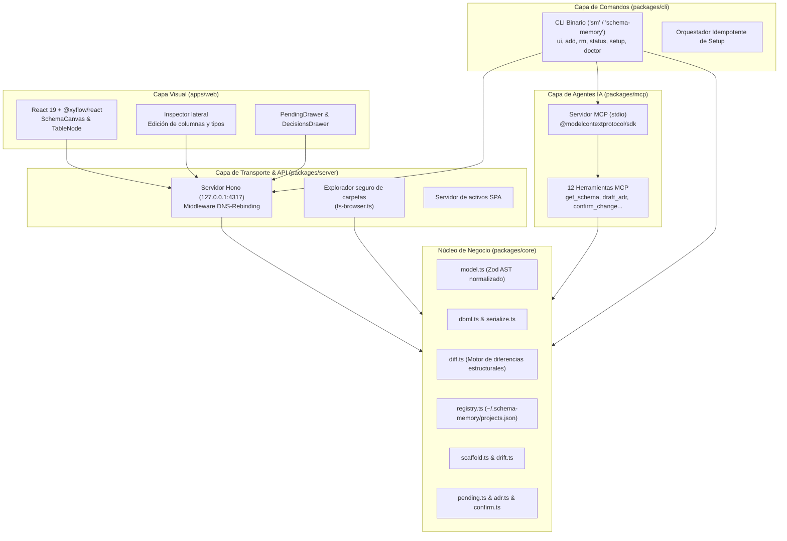

# Arquitectura de Sistemas y Estructura Interna

Este documento detalla el diseño de sistemas, principios arquitectónicos y estructura interna del monorepo de **`schema-memory`**.

---

## 1. Principios de Diseño

1. **Aislamiento del Núcleo (`core` agnóstico)**:
   Toda la lógica de dominio (modelos, parseo DBML, cálculo de diferencias, ADRs y registro) reside en `@schema-memory/core`, sin dependencias de Node.js runtime específicos, HTTP ni React.
2. **Zero Docker**:
   Ejecución nativa directa sobre Node.js (>=20.5) y Bun (>=1.1). Sin contenedores, bases de datos externas ni daemon pesado en background.
3. **Seguridad Local Anti DNS-Rebinding**:
   El servidor backend Hono valida estrictamente los encabezados `Host` (`127.0.0.1`, `localhost`) y `Origin` para bloquear invocaciones no autorizadas desde navegadores externos.
4. **AST DBML Determinista y Normalizado**:
   Se utiliza `@dbml/core` para el parseo inicial, pero el modelo interno se normaliza mediante esquemas de **Zod**. La serialización a DBML es determinista para garantizar diffs limpios en Git.
5. **Transacciones Atómicas de Esquema**:
   La confirmación de un cambio actualiza el archivo canónico `schema.dbml`, genera el ADR en Markdown inmutable y limpia los borradores en una sola operación atómica con rollback en caso de error.
6. **Compresión Gzip & Caché HTTP ETag**:
   El servidor Hono descomprime automáticamente peticiones con `Content-Encoding: gzip` y comprime respuestas salientes. El endpoint de esquema implementa cabeceras `ETag` calculadas a partir del fingerprint del proyecto, respondiendo con `304 Not Modified` ante peticiones condicionales `If-None-Match`.
7. **Caché en Memoria LRU & Reducción de Tokens**:
   El parseo y validación de AST DBML está acelerado por una caché LRU indexada por hash criptográfico del contenido. Los agentes pueden solicitar esquemas filtrados por tabla (`filterSchemaByTables`) para minimizar tokens consumidos.

---

## 2. Diagrama de Arquitectura

---

## 3. Desglose de Paquetes (`packages/` y `apps/`)

### 3.1 `@schema-memory/core` (`packages/core/`)
La biblioteca central compartida:
- **`src/model.ts`**: Esquemas Zod normalizados (`SchemaModel`, `Table`, `Column`, `Ref`, `Enum`, `ProjectConfig`, `PendingChange`, `AdrDraft`). Aísla al sistema de fluctuaciones en el parser externo.
- **`src/dbml.ts` & `src/serialize.ts`**: Conversión bidireccional entre texto DBML y AST normalizado con serialización consistente de tablas, campos, llaves foráneas y notas. Incluye **caché LRU** de AST (`MAX_SCHEMA_CACHE = 64`) y la función `filterSchemaByTables` para podar esquemas y ahorrar tokens en prompts de IA.
- **`src/compression.ts`**: Utilidades de compresión (`gzipBuffer`, `gunzipBuffer`, `isGzipPayload`) sobre `node:zlib` para optimizar payloads de red.
- **`src/diff.ts`**: Compara dos esquemas determinando tablas añadidas/eliminadas, columnas alteradas o renombradas y relaciones intervenidas.
- **`src/registry.ts` & `src/config.ts`**: Gestión de catálogo global de proyectos (`~/.schema-memory/projects.json`) y configuraciones locales con invalidación inteligente basada en `mtimeMs` y tamaño de archivo.
- **`src/scaffold.ts`**: Inicializa nuevos proyectos (`planAddProject` / `applyAddProject`), inyectando de forma idempotente las reglas de guardrail en el `AGENTS.md` del repositorio cliente.
- **`src/pending.ts` & `src/adr.ts`**: Manejo de cambios en borrador (`.schema-memory/pending/change.json`), verificación rápida de estado (`getPendingStatus`, `countAdrsStatus`) y generación de ADRs en Markdown con frontmatter YAML.
- **`src/confirm.ts`**: Ejecuta la transacción atómica: sincroniza `schema.dbml`, crea `adr/000X-[slug].md`, borra borradores y devuelve el payload `engramSummary`.
- **`src/hash.ts`**: Normalización determinista de DBML y cálculo del `computeProjectFingerprint` para invalidación de cachés ETag.
- **`src/drift.ts`**: Compara el esquema canónico DBML contra modelos del repositorio cliente para advertir desincronizaciones.

### 3.2 `@schema-memory/mcp` (`packages/mcp/`)
Servidor bajo el estándar Model Context Protocol:
- Comunicación mediante entrada y salida estándar (`stdio`).
- Resolución automática de proyecto por CWD del proceso, flag explícito `--project`, o fallback de proyecto único registrado.
- Expone las 12 herramientas MCP optimizadas para ahorro de tokens de contexto (soporte de filtrado por tablas en `get_schema`, exclusión de `rawMarkdown` por defecto en `get_adr` y serialización JSON compacta).

### 3.3 `@schema-memory/server` (`packages/server/`)
Servidor HTTP local montado sobre **Hono**:
- Escucha de forma predeterminada en `127.0.0.1:4317` (puerto configurable mediante el flag `-p / --port`).
- **Seguridad**: Middleware de verificación estricta de `Host` y `Origin` anti DNS-rebinding (solo admite invocaciones locales).
- **Manejo de Gzip**: Middleware `gunzipRequestMiddleware` para descompresión transparente de cuerpos de petición entrantes (`Content-Encoding: gzip`) y compresión automática de respuestas salientes (excluyendo streams SSE `/events`).
- **Caché Condicional ETag**: Endpoint `/api/projects/:id/schema` calcula ETags y responde `304 Not Modified` cuando el fingerprint no ha variado.
- **`fs-browser.ts`**: API para navegar unidades y carpetas del disco local dentro del modal de agregar proyecto en la UI web (con soporte completo de unidades Windows `C:`, `D:`, etc.).
- **Modo Producción & Caché de Activos**: Sirve los activos precompilados de `apps/web/dist` con encabezados `Cache-Control: public, max-age=31536000, immutable` en `/assets/*`.

### 3.4 `@schema-memory/cli` (`packages/cli/`)
Punto de entrada empaquetado para distribución en npm:
- **Empaquetado Autocontenido (Zero External Fetch)**: Durante el build, los activos estáticos compilados de `apps/web/dist` se copian dentro de `packages/cli/dist/web/`. Al ejecutar `npx schema-memory` o `sm`, el servidor sirve la aplicación SPA directamente desde el paquete local, garantizando funcionamiento 100% offline y sin descargas externas.
- Comandos: `ui` (por defecto, alias `sm`), `add` (alias: `init`), `status` (alias: `ls`), `remove` (alias: `rm`), `mcp`, `setup` y `doctor`.
- Shims multiplataforma para macOS, Linux y Windows (`.cmd` y `.ps1` nativos sin Developer Mode ni permisos de administrador).
- Detección interactiva de primera ejecución para ofrecer `sm setup`.

### 3.5 `apps/web` (`apps/web/`)
Single Page Application reactiva:
- **`SchemaCanvas.tsx`**: Lienzo visual basado en `@xyflow/react` v12 con zoom, pan, modo bloqueo (`Lock`/`Unlock`) y centrado animado (`fitView`).
- **`TableNode.tsx`**: Nodo visual con handles de conexión, badges PK/FK/UQ y notas.
- **`Inspector.tsx`**: Panel lateral para edición de atributos de tablas y campos.
- **`PendingDrawer.tsx`**: Cajón de diferencias pendientes con botón para copiar el prompt de debate para el agente de IA.
- **`DecisionsDrawer.tsx`**: Línea de tiempo cronológica de ADRs con filtros por entidad.
- **`AddProjectModal.tsx`**: Asistente en 4 pasos con preview dry-run y explorador de rutas locales.

---

## 4. Matriz de Stack Tecnológico

| Capa | Tecnologías | Propósito |
| :--- | :--- | :--- |
| **Runtime & Gestor** | Node.js 22, Bun 1.1+, pnpm 9 | Entorno modular con workspaces y cero dependencias de Docker |
| **Lenguaje** | TypeScript 5.7 (ESM nativo, Strict) | Tipado estricto extremo a extremo |
| **Modelado DBML** | `@dbml/core`, `zod` | Parseo, validación y serializador determinista |
| **Protocolo Agentes** | `@modelcontextprotocol/sdk` (v1.x) | 12 tools stdio para Antigravity, OpenCode y Claude Code |
| **Backend REST** | `hono`, `@hono/node-server`, `hono/compress` | Servidor ultraligero local con protección anti DNS-rebinding y compresión HTTP |
| **Compresión & Caching** | `node:zlib`, ETags, LRU AST cache | Optimización de ancho de banda y latencia en transferencias pesadas de esquema |
| **Frontend Web** | React 19, `@xyflow/react` v12, Zustand, Vite 6 | Canvas visual interactivo y gestión reactiva de estado |
| **CLI** | `commander` | CLI binario `schema-memory` / `sm` |
| **Testing** | `vitest` | Pruebas unitarias e integración en todos los paquetes |
