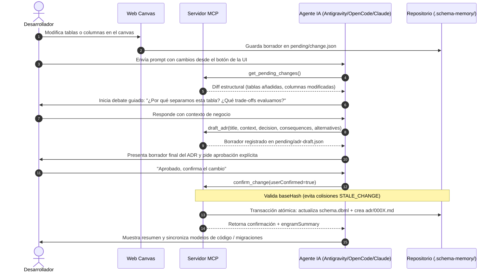

# Protocolo MCP e Integración con Agentes de Inteligencia Artificial

Este documento describe la integración de **`schema-memory`** con asistentes y agentes de IA (Google Antigravity, OpenCode, Claude Code, Cursor) a través del **Model Context Protocol (MCP)**.

---

## 1. Servidor MCP y Transporte

El servidor MCP está implementado en `@schema-memory/mcp` utilizando el SDK oficial `@modelcontextprotocol/sdk`.

- **Transporte**: Entrada y salida estándar (`stdio`).
- **Capacidades**: 12 herramientas, 3 prompts guiados y recursos/templates de esquema y ADRs.
- **Comando de inicio**:
  - Directo / Zero-Install: `npx -y schema-memory mcp` (o `bunx schema-memory mcp`).
  - Global: `sm mcp`.
- **Resolución de proyecto**:
  1. Parámetro explícito `--project <id|path>` en el tool call.
  2. Detección automática por directorio de trabajo actual (`process.cwd()`).
  3. Proyecto único si solo hay un proyecto registrado en `~/.schema-memory/projects.json`.

---

## 2. Las 12 Herramientas MCP Disponibles

| Herramienta | Parámetros principales | Descripción |
| :--- | :--- | :--- |
| `list_projects` | — | Lista todos los proyectos registrados localmente con conteo rápido de cambios pendientes y ADRs. |
| `get_schema` | `project?: string, format?: "dbml" \| "summary" \| "both", tables?: string[]` | Devuelve el DBML canónico. El parámetro `tables` permite aislar un subgrafo específico y sus relaciones conexas (`includeConnected: true`) para reducir el consumo de tokens de contexto. |
| `get_pending_changes` | `project?: string` | Retorna el diff estructural pendiente generado desde la Web UI o propuesto por la IA. |
| `propose_change` | `project?: string, schema: string, reason?: string` | Permite al agente proponer un cambio estructural desde el chat sin escribir directamente en archivos del cliente. |
| `draft_adr` | `project?: string, title: string, context: string, decision: string, consequences: string, alternatives?: string[]` | Redacta o actualiza el borrador de ADR en `.schema-memory/pending/adr-draft.json`. |
| `confirm_change` | `project?: string, userConfirmed: boolean` | **Transacción atómica**: Aplica el cambio a `schema.dbml`, crea el archivo `adr/000X-[slug].md` y devuelve `engramSummary`. Falla si `userConfirmed != true` o si el cambio está desactualizado (`STALE_CHANGE`). |
| `discard_change` | `project?: string` | Cancela el cambio pendiente y limpia la carpeta `.schema-memory/pending/`. |
| `get_decisions` | `project?: string, table?: string, column?: string, status?: "propuesto" \| "confirmado" \| "reconstruido", limit?: number` | Consulta el histórico de ADRs del proyecto con filtros granulares por entidad o estado. |
| `get_adr` | `project?: string, id: string, includeRawMarkdown?: boolean` | Lee los campos estructurados de un ADR específico. `includeRawMarkdown` es `false` por defecto para ahorrar tokens. |
| `confirm_adr` | `project?: string, id: string` | Promueve un ADR existente de estado `reconstruido` a `confirmado` tras revisión humana. |
| `import_schema` | `project?: string, dbml: string, dialect?: string, adrs?: Array<{ title, context, decision, consequences, alternatives }>` | Inicializa o sobrescribe el esquema DBML inicial y genera ADRs iniciales concurrentemente. |
| `check_drift` | `project?: string, candidateDbml: string` | Compara un DBML candidato extraído de código/migraciones contra el `schema.dbml` canónico para certificar paridad. |

### 2.1 MCP Prompts y comandos slash

Además de las herramientas, el servidor registra **3 prompts guiados**. Los agentes que soportan MCP prompts los muestran como comandos o los ofrecen al modelo:

| Prompt | Argumento | Flujo que inicia |
| :--- | :--- | :--- |
| `bootstrap_project` | `project?` | Inspecciona modelos/migraciones, sintetiza el DBML inicial y llama a `import_schema` con ADRs reconstruidos. |
| `debate_pending_change` | `project?` | Revisa el cambio pendiente, pregunta trade-offs y alternativas, y redacta el borrador de ADR. |
| `check_drift` | `project?` | Extrae el esquema actual del código, lo compara con `schema.dbml` y reporta divergencias. |

#### OpenCode

OpenCode registra cada MCP prompt como un comando con el formato `/<servidor>:<prompt>`. Como el servidor se declara con la clave `schema-memory` en `opencode.json`, los comandos son:

- `/schema-memory:bootstrap_project`
- `/schema-memory:debate_pending_change`
- `/schema-memory:check_drift`

Reglas de uso:

- El texto que escribís después del comando se pasa como primer argumento del prompt (`project`). Por ejemplo: `/schema-memory:check_drift mi-proyecto`.
- Ejecutá un comando por vez. No encadenes otro `:comando` en el mismo mensaje; el segundo texto se interpretaría como argumento.
- No hace falta crear archivos en `~/.config/opencode/commands/`: los comandos se generan automáticamente desde el servidor MCP.
- Si cambiás la clave del servidor en `opencode.json`, cambia también el prefijo de los comandos.

#### Antigravity

- El plugin bundle incluye un skill llamado `schema-memory`. En Antigravity App/IDE se puede invocar manualmente como `/schema-memory`; en Antigravity CLI los skills se convierten automáticamente en slash commands.
- La disponibilidad de los MCP prompts depende de la superficie y la versión de Antigravity. Usá `/skills` para ver los skills cargados y `/mcp` para inspeccionar el servidor.
- El comando `/schema-memory` acepta instrucciones en lenguaje natural después del nombre: `/schema-memory revisá el drift contra las migraciones`.

#### Agent Skills estándar

Los hosts que implementan la especificación abierta de skills pueden exponer `/schema-memory` como slash command. Si el host no convierte skills en comandos, el agente descubre el skill automáticamente por su descripción.

---

## 3. Protocolo de Pair Programming y Debate Guiado

Para evitar que los agentes apliquen cambios silenciosos o arbitrarios en bases de datos de producción, `schema-memory` impone un flujo de debate obligatorio:



---

## 4. Configuración por Entorno de Agente

El comando `sm setup` (o `npx schema-memory setup`) configura **solo los entornos seleccionados** y no destruye configuraciones existentes. Sin `--target`, abre un wizard interactivo; en entornos no interactivos usa todos los targets con el perfil `recommended` para mantener compatibilidad.

### 4.1 OpenCode (`~/.config/opencode/`)

```bash
sm setup --target opencode --profile recommended
```

- Inyecta el servidor en `~/.config/opencode/opencode.json` con el formato nativo V2:
  ```json
  {
    "mcp": {
      "servers": {
        "schema-memory": {
          "type": "local",
          "command": ["npx", "-y", "schema-memory", "mcp"]
        }
      }
    }
  }
  ```
- Según el perfil:
  - `minimal`: solo MCP.
  - `recommended`: MCP + skill en `~/.config/opencode/skills/schema-memory/SKILL.md`.
  - `strict`: MCP + skill + bloque de reglas en `~/.config/opencode/AGENTS.md`.
- Los MCP prompts se exponen automáticamente como comandos `/schema-memory:bootstrap_project`, `/schema-memory:debate_pending_change` y `/schema-memory:check_drift`. No se crean archivos en `commands/`.

### 4.2 Google Antigravity

#### App/IDE (`~/.gemini/config/`)

```bash
sm setup --target antigravity --profile recommended
```

- Instala el plugin bundle en `~/.gemini/config/plugins/schema-memory/`:
  - `plugin.json` con el esquema oficial de Antigravity.
  - `mcp_config.json` con el servidor `schema-memory-mcp`.
  - `skills/schema-memory/SKILL.md`.
  - `rules/AGENTS.md` solo en el perfil `strict`.
- El plugin se detecta desde la sección **Customizations** de Antigravity App/IDE.
- El skill expone el comando `/schema-memory`. También podés inspeccionar los skills cargados con `/skills`.
- En el perfil `minimal` no se instala el plugin: solo se registra el MCP global en `~/.gemini/config/mcp_config.json`.

#### CLI

```bash
sm setup --target antigravity-cli --profile recommended
```

- Genera el bundle en `~/.schema-memory/plugins/antigravity/schema-memory/`.
- Si `agy` está disponible, ejecuta `agy plugin install <ruta>`; si no, imprime el comando exacto.
- Verificá la importación con `agy plugin list` o `/plugin list`.
- Una vez importado, el skill se convierte en `/schema-memory` y el plugin aporta su propio `mcp_config.json`.
- En el perfil `minimal` solo se escribe `~/.gemini/config/mcp_config.json`; no se importa ningún plugin.

#### Gestión de plugins

- `/plugin` o `/plugins`: abre el gestor interactivo.
- `/plugin list`, `/plugin enable schema-memory`, `/plugin disable schema-memory`.
- `agy plugin list`, `agy plugin install`, `agy plugin enable`, `agy plugin disable`.

> Si actualizás desde una versión anterior, puede quedar un `mcp_config.json` global con `schema-memory-mcp`. El setup no lo borra; si el cliente muestra herramientas duplicadas, eliminá esa entrada y dejá solo el plugin.

### 4.3 Claude Code
Registra el servidor directamente desde tu terminal:
```bash
claude mcp add schema-memory -- npx -y schema-memory mcp
```

### 4.4 Cursor
Añade la siguiente entrada en `~/.cursor/mcp.json` (o en Cursor Settings → MCP):
```json
{
  "mcpServers": {
    "schema-memory": {
      "command": "npx",
      "args": ["-y", "schema-memory", "mcp"]
    }
  }
}
```

### 4.5 Estándar Abierto Agent Skills (`~/.agents/`)

```bash
sm setup --target agents
```

- Publica el skill universal en `~/.agents/skills/schema-memory/SKILL.md`, compatible con herramientas que implementan la especificación abierta de habilidades para agentes.
- No escribe configuración de OpenCode ni de Antigravity.

### 4.6 Instalación selectiva y perfiles

| Opción | Descripción |
| :--- | :--- |
| `--target <lista>` | Targets separados por coma: `opencode`, `antigravity`, `antigravity-cli`, `agents` o `all`. |
| `--profile <perfil>` | `minimal`, `recommended` (default) o `strict`. |
| `--print` | Imprime la configuración de los targets elegidos sin escribir archivos. |
| `--yes` | Evita confirmaciones interactivas. |
| `--refresh-projects` | Actualiza el bloque de `AGENTS.md` en todos los proyectos registrados. Ya no se ejecuta por defecto. |
| `--cli-only` | Solo enlaza el binario global `sm`. |
| `--install-global` / `--no-install-global` | Controla la instalación global del CLI. |

| Target | `minimal` | `recommended` | `strict` |
| :--- | :--- | :--- | :--- |
| `opencode` | MCP | MCP + skill | MCP + skill + reglas |
| `antigravity` | MCP global | Plugin (MCP + skill) | Plugin (MCP + skill + reglas) |
| `antigravity-cli` | MCP global | Plugin importado | Plugin importado + reglas |
| `agents` | Skill | Skill | Skill |

Reglas de aislamiento del setup:

- `--target opencode` no escribe en `~/.gemini` ni en `~/.agents`.
- `--target antigravity` no escribe en `~/.config/opencode` ni en `~/.agents`.
- `--target agents` no escribe configuración de agentes específicos.
- `sm doctor` solo valida los targets registrados en `~/.schema-memory/setup.json`.

### 4.7 Matriz de comandos por agente

| Agente | Comando | Origen |
| :--- | :--- | :--- |
| OpenCode | `/schema-memory:bootstrap_project` | MCP prompt `bootstrap_project` |
| OpenCode | `/schema-memory:debate_pending_change` | MCP prompt `debate_pending_change` |
| OpenCode | `/schema-memory:check_drift` | MCP prompt `check_drift` |
| Antigravity App/IDE | `/schema-memory` | Skill del plugin |
| Antigravity CLI | `/schema-memory` | Skill del plugin importado |
| Agent Skills estándar | `/schema-memory` (si el host lo soporta) | Skill universal |
| Claude Code / Cursor | — | Solo MCP; se invoca en lenguaje natural |

---

## 5. Regla de Aislamiento Estricto (Guardrail)

En los proyectos cliente registrados se inyecta la siguiente directiva en `AGENTS.md`:

> **Aislamiento Estricto**: Interactúa con `schema-memory` ÚNICAMENTE a través de sus herramientas MCP (`schema-memory` / `schema-memory-mcp`). NUNCA busques ni leas el código fuente del repositorio de `schema-memory`. Si las herramientas MCP no están cargadas en la sesión actual, detén la ejecución y solicita al usuario ejecutar `sm setup`.

### ¿Por qué existe esta regla?
Cuando un desarrollador trabaja en un proyecto de cliente que utiliza `schema-memory`, el agente debe interactuar con el esquema a través del protocolo oficial y no intentar inferir o ejecutar scripts del código fuente interno del motor, garantizando la inmutabilidad de los ADRs y la integridad del archivo DBML canónico.

---

## 6. Optimización de Tokens de Contexto para Modelos LLM

Para esquemas grandes de bases de datos (docenas o cientos de tablas), `schema-memory` incorpora mecanismos para no saturar la ventana de contexto del agente:

1. **Filtrado por Tablas en `get_schema`**:
   Permite pasar un array de tablas `tables: ["orders", "payments"]`. El servidor no solo filtra esas tablas sino que incluye automáticamente sus relaciones y tipos enum asociados (`includeConnected: true`), aislando el subgrafo exacto de trabajo.
2. **ADRs Estructurados sin Volcado Markdown**:
   La herramienta `get_adr` devuelve por defecto los campos estructurados (`title`, `context`, `decision`, `consequences`, `alternatives`, `diffText`), omitiendo `rawMarkdown` salvo que se especifique `includeRawMarkdown: true`.
3. **Serialización JSON Minificada**:
   Los recursos y respuestas MCP serializan payloads JSON de manera compacta para minimizar el consumo de tokens en prompts.
