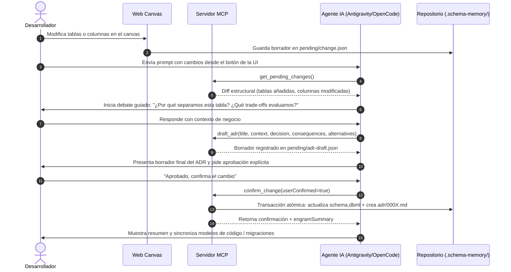

# Protocolo MCP e Integración con Agentes de Inteligencia Artificial

Este documento describe la integración de **`schema-memory`** con asistentes y agentes de IA (Google Antigravity, OpenCode, Claude Code, Cursor) a través del **Model Context Protocol (MCP)**.

---

## 1. Servidor MCP y Transporte

El servidor MCP está implementado en `@schema-memory/mcp` utilizando el SDK oficial `@modelcontextprotocol/sdk`.

- **Transporte**: Entrada y salida estándar (`stdio`).
- **Comando de inicio**:
  - Directo / Zero-Install: `npx -y schema-memory mcp` (o `bunx schema-memory mcp`).
  - Global: `sm mcp`.
- **Resolución de proyecto**:
  1. Parámetro explícito `--project <id|path>` en el tool call.
  2. Detección automática por directorio de trabajo actual (`process.cwd()`).
  3. Proyecto único si solo hay un proyecto registrado en `~/.schema-memory/projects.json`.

---

## 2. Las 12 Herramientas MCP Disponibles

| Herramienta | Parámetros principales | Descripción |
| :--- | :--- | :--- |
| `list_projects` | — | Lista todos los proyectos registrados localmente. |
| `get_schema` | `project?: string` | Devuelve el contenido íntegro del `schema.dbml` canónico. |
| `get_pending_changes` | `project?: string` | Retorna el diff estructural pendiente generado desde la Web UI o por la IA. |
| `propose_change` | `project?: string, schema: string, reason?: string` | Permite al agente proponer un cambio estructural desde el chat sin tocar archivos. |
| `draft_adr` | `project?: string, title: string, context: string, decision: string, consequences: string, alternatives?: string[]` | Redacta o actualiza el borrador de ADR en `.schema-memory/pending/adr-draft.json`. |
| `confirm_change` | `project?: string, userConfirmed: boolean` | **Transacción atómica**: Aplica el cambio a `schema.dbml`, crea el archivo `adr/000X-[slug].md` y devuelve `engramSummary`. Falla si `userConfirmed != true`. |
| `discard_change` | `project?: string` | Cancela el cambio pendiente y limpia la carpeta `.schema-memory/pending/`. |
| `get_decisions` | `project?: string, table?: string, limit?: number` | Consulta el histórico de ADRs del proyecto, opcionalmente filtrado por tabla. |
| `get_adr` | `project?: string, id: string` | Lee el texto completo de un ADR específico por su identificador. |
| `confirm_adr` | `project?: string, id: string` | Marca un ADR existente como confirmado. |
| `import_schema` | `project?: string, dbml: string, dialect?: string` | Inicializa o sobrescribe el esquema DBML inicial. |
| `check_drift` | `project?: string` | Compara el DBML canónico con los esquemas ORM locales del proyecto (Prisma, Django, etc.). |

---

## 3. Protocolo de Pair Programming y Debate Guiado

Para evitar que los agentes apliquen cambios silenciosos o arbitrarios en bases de datos de producción, `schema-memory` impone un flujo de debate obligatorio:



---

## 4. Configuración por Entorno de Agente

El comando `sm setup` (o `npx schema-memory setup`) configura automáticamente los diferentes entornos sin destruir configuraciones existentes:

### 4.1 OpenCode (`~/.config/opencode/`)
- Inyecta el servidor en `~/.config/opencode/opencode.json` con el formato nativo V2:
  ```json
  {
    "mcp": {
      "servers": {
        "schema-memory": {
          "type": "stdio",
          "command": "npx",
          "args": ["-y", "schema-memory", "mcp"]
        }
      }
    }
  }
  ```
- Agrega el bloque de reglas en `~/.config/opencode/AGENTS.md`.
- Instala el skill en `~/.config/opencode/skills/schema-memory/SKILL.md`.

### 4.2 Google Antigravity (`~/.gemini/config/`)
- Registra el servidor en `~/.gemini/config/mcp_config.json` bajo `schema-memory-mcp`.
- Añade la regla global en `~/.gemini/config/GEMINI.md`.
- Instala el paquete de plugin en `~/.gemini/config/plugins/schema-memory/`.

### 4.3 Estándar Abierto Agent Skills (`~/.agents/`)
- Publica el skill universal en `~/.agents/skills/schema-memory/SKILL.md`, compatible con herramientas que implementan la especificación abierta de habilidades para agentes.

---

## 5. Regla de Aislamiento Estricto (Guardrail)

En los proyectos cliente registrados se inyecta la siguiente directiva en `AGENTS.md`:

> **Aislamiento Estricto**: Interactúa con `schema-memory` ÚNICAMENTE a través de sus herramientas MCP (`schema-memory` / `schema-memory-mcp`). NUNCA busques ni leas el código fuente del repositorio de `schema-memory`. Si las herramientas MCP no están cargadas en la sesión actual, detén la ejecución y solicita al usuario ejecutar `sm setup`.

### ¿Por qué existe esta regla?
Cuando un desarrollador trabaja en un proyecto de cliente que utiliza `schema-memory`, el agente debe interactuar con el esquema a través del protocolo oficial y no intentar inferir o ejecutar scripts del código fuente interno del motor, garantizando la inmutabilidad de los ADRs y la integridad del archivo DBML canónico.
